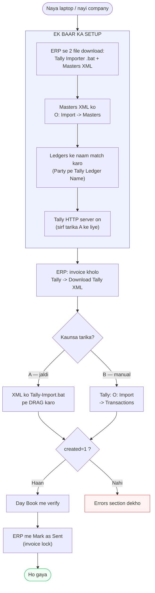
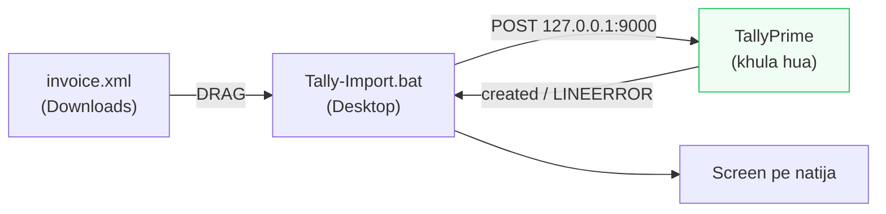
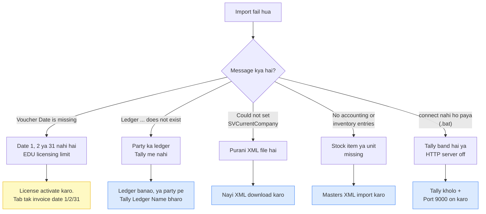

# Invoice se Tally tak

ERP me invoice banane ke baad usse Tally me kaise le jaana hai — **do tarike**,
dono ka poora flow.

| Tarika | Kiske liye | Kya chahiye |
|---|---|---|
| **A — Importer (.bat)** | Roz kaam karne wale ke liye. Ek drag, ho gaya. | Ek baar setup + Tally ka HTTP server on |
| **B — Manual** | Jab .bat na chale, ya doosre computer pe | Kuch bhi install nahi |

Dono ka natija bilkul same hai — wahi XML jaati hai, bas pahunchane ka rasta alag.

---

## Poora Picture



---

## Ek Baar Ka Setup

Sirf pehli baar — ya jab naya computer / nayi Tally company use karo.

### 1. Do file ERP se download karo

ERP me koi bhi invoice kholo → **`Tally`** button → neeche **"One-time setup"**:

| Link | Kya hai |
|---|---|
| **Tally Importer (.bat)** | Ek-click importer. Isko **Desktop** pe rakh do. |
| **Masters XML** | Ledgers, `Kgs` unit aur stock item ek saath bana deta hai |

### 2. Masters Tally me daalo

```
Tally kholo  ->  sahi company kholo

O: Import  ->  Masters
   File Format                        : XML (Data Interchange)
   File to Import                     : tally-masters-setup.xml
   Backup Company Data before Import  : No
   Behaviour if master already exists : Ignore Duplicates
Ctrl+A
```

Isse ye ban jate hain:

| Type | Name |
|---|---|
| Unit | `Kgs` |
| Ledger | `Sales` |
| Ledger | `Central Tax on Sales @ 9%` |
| Ledger | `State Tax on Sales @ 9%` |
| Ledger | `Integrated Tax on Sales @ 18%` |
| Ledger | `Round Off` |
| Stock Item | `Vacuum Heat Treatment 18%` |

> Agar tumhare Tally me ye ledgers **pehle se** kisi aur naam se hain (jaise
> `Output CGST`), to Masters XML mat daalo. Uske bajaye jo naam pehle se hain
> wahi ERP ko bata do — neeche **"Ledger ke naam match karna"** dekho.

### 3. Ledger ke naam match karna

Tally ledger ko **naam se** dhoondhta hai aur import pe kuch **khud nahi banata**.
Naam me ek space ka farak bhi:

```
Ledger 'MAPTEST ERP NAME' does not exist!
```

**Party ke liye** — ERP me party kholo, **`Tally Ledger Name`** field bharo
(GSTIN/PAN ke neeche):

```
ERP me party ka naam  :  VIJAY ENGINEERING- AURANGABAD
Tally me ledger       :  VIJAY ENGINEERING
                             |
                             v
      Party pe "Tally Ledger Name" me likho: VIJAY ENGINEERING
```

Invoice pe naam nahi badlega — sirf Tally ko bheja jaane wala naam badlega.
Khali chhod do to party ka naam hi jayega.

**Sales / tax ledger ke liye** — ye `.env` se aate hain. Asli naam nikalne ke liye,
jis computer pe Tally khula hai wahan:

```bash
cd backend
node scripts/tally-masters.js
```

Ye company, ledgers, stock items aur units ke asli naam print kar deta hai.
Unhe `.env` me `TALLY_LEDGER_*` me daal kar redeploy karo.

### 4. Tally ka HTTP server on karo

Sirf **tarika A** ke liye chahiye. Manual import ke liye zaroorat nahi.

```
F1: Help  ->  Settings  ->  Connectivity
          ->  Client/Server configuration
   TallyPrime acts as : Both
   Port               : 9000
Ctrl+A
```

> Tally band karke dobara kholne pe ye setting kabhi-kabhi off ho jati hai.
> Agar `.bat` "connect nahi ho paya" bole to sabse pehle yahi check karo.

---

## Roz Ka Kaam

### Pehla step — dono tarike me same

ERP me invoice kholo → **`Tally`** button → **`Download Tally XML`**

File `Downloads` folder me aa jayegi, naam kuch aisa: `SVT-26-27-0008_tally.xml`

---

### Tarika A — Importer (.bat)



**XML file ko `Tally-Import.bat` pe drag karo.** Bas.

Ya `.bat` ko **double-click** karo — Downloads se sabse nayi `*_tally.xml` khud utha lega.

Screen pe aisa dikhega:

```
  File  : C:\Users\Shree\Downloads\SVT-26-27-0008_tally.xml
  Tally : http://127.0.0.1:9000

  created=1  errors=0  exceptions=0

  [OK] Voucher Tally me import ho gaya.
```

Agar galat hua to `.bat` khud batayega ki kya galat hai aur kya karna hai.

---

### Tarika B — Manual

```
Tally kholo  —  SAHI COMPANY khuli honi chahiye

O: Import  ->  Transactions          <--  "Masters" NAHI

   File Format    : XML (Data Interchange)
   File Path      : C:\Users\<naam>\Downloads
   File to Import : SVT-26-27-0008_tally.xml
   Backup         : No

Ctrl+A
```

Koi exception screen na aaye = import ho gaya.

> **Sabse aam galti:** `Masters` aur `Transactions` me confusion.
> Invoice hamesha **Transactions** se jaati hai. `Masters` sirf ledger / stock item ke liye.

---

### Aakhri step — dono tarike me same

1. **Verify:** Tally → `Day BooK` → `F2: Date` → invoice ki date
2. **ERP me wapas:** invoice → `Tally` → **`Mark as Sent (Lock Invoice)`**

Lock karne se invoice pakki ho jati hai aur galti se badli nahi ja sakti.

---

## Naya Customer Aaye To

Import se **pehle** uska ledger Tally me banao:

```
Gateway of Tally  ->  Create  ->  Ledger

   Name                           : <ERP wala naam, copy-paste karo>
   Under                          : Sundry Debtors    <-- Capital Account NAHI
   Maintain balances bill-by-bill : Yes
Ctrl+A
```

> Save hone ke baad Tally dobara Create screen kholta hai — `Esc` dabao.
> `Ctrl+A` phir se dabaya to **"Name already exists"** aayega — matlab ledger
> **ban chuka hai**, sab theek hai.

Agar Tally me naam alag rakhna hai, to ERP me us party pe **Tally Ledger Name**
bhar do (upar setup step 3 dekho).

---

## Verify Kahan Karo

| Kya dekhna hai | Navigation |
|---|---|
| **Voucher aaya ya nahi** | `Day BooK` → `F2: Date` → invoice ki date |
| Poore saal ke vouchers | `Day BooK` → `Alt+F2` → 1-4-2026 se 31-3-2027 |
| Invoice-wise list | `Display More Reports` → `Account Books` → `Sales Register` |
| Party ka outstanding | `Display More Reports` → `Account Books` → `Ledger` → party → `Alt+F2` |
| Item ka kaam (Kgs) | `Stock Summary` → `Alt+F2` |
| Voucher ka poora detail | Day Book me voucher pe **Enter** |

**Sabse tez clue:** Gateway of Tally pe **`DATE OF LAST ENTRY`** dekho.
Wahan invoice ki date dikh rahi hai = voucher andar hai.

> `Vouchers` aur `Day BooK` alag hain:
> **`Vouchers`** = naya banao (galti se yahan mat jao) · **`Day BooK`** = bane hue dekho

---

## Errors



| Screen pe likha | Asli matlab | Hal |
|---|---|---|
| **Voucher Date is missing** | Date XML me **hai** — bas EDU mode use accept nahi karta | License activate karo; tab tak date 1, 2 ya 31 |
| **Ledger '…' does not exist!** | Us naam ka ledger Tally me nahi | Ledger banao, ya party pe `Tally Ledger Name` bharo |
| **Could not set 'SVCurrentCompany'** | Purani XML jisme company ka naam bhara tha | Nayi XML download karo |
| **No accounting or inventory entries** | Stock item / unit missing | Masters XML import karo |
| **Name already exists** (ledger banate waqt) | Ledger ban chuka hai | `Esc`, aage badho |
| **connect nahi ho paya (curl error 7)** | Tally band, ya HTTP server off | Tally kholo, Port 9000 on karo |

### "Voucher Date is missing" — ye jhooth bolta hai

Date XML me hoti hai. Ye humne khud test karke dekha — same file, sirf date badli:

```
<DATE>20260806</DATE>  (6-Aug)   ->  created=0   "Voucher date is missing"
<DATE>20260802</DATE>  (2-Aug)   ->  created=1   PASS
```

TallyPrime **EDU** sirf mahine ki **1, 2 aur 31** tarikh ke vouchers leta hai.
Koi aur date ho to wo reject karke yahi ulajhane wala message deta hai.
**Licensed Tally me ye limit nahi hai.**

---

## Sawal — Jawab

**Q. Galti se do baar import kar diya to duplicate ban jayegi?**
Nahi. Har invoice ke XML me ek sthir key jaati hai (`REMOTEID`). Dusri baar Tally
naya voucher banane ke bajaye **usi ko update** kar deta hai.

```
import #1   created=1
import #2   created=0  altered=1
import #3   created=0  altered=1
Tally me: 1 voucher
```

Ye protection **ek company ke andar** kaam karti hai. Galti se **doosri company**
me import kar diya to wahan naya voucher ban jayega — isliye import se pehle
sahi company kholna zaroori hai.

**Q. Invoice sudhar kar dobara bheju to?**
Wahi upar wali baat — Tally purane voucher ko update kar dega, doosra nahi banayega.

**Q. Print pe item ka naam nahi chahiye, sirf process?**
Invoice banate waqt Services/Items me checkbox hai —
**"Print me item ka naam bhi dikhao"**. Tick hata do.

**Q. XML ke alawa aur format?**
`JSON` aur `Excel` bhi download ho sakte hain. Par **Tally me import sirf XML se hota hai** —
Tally vouchers ke liye JSON support karta hi nahi. Excel Tally ke apne template se
hi jata hai. JSON/Excel doosre software ko data dene ya record rakhne ke liye hain.

**Q. Tally band hai to?**
Manual tarika (B) tab bhi kaam nahi karega — Tally to kholna hi padega.
Farak sirf itna hai ki tarika B me **HTTP server** on karne ki zaroorat nahi.

---

## Reference — Keyboard Shortcuts

| Key | Kaam |
|---|---|
| `O` | Import menu |
| `K` | Day Book (Gateway se) |
| `F2` | Date badlo |
| `Alt+F2` | Period (range) badlo |
| `Ctrl+A` | Accept / Save |
| `Esc` | Peeche jao / dialog band karo |
| `F3` | Company badlo |
| `Alt+F` | Search |

---

## Do Sunehre Niyam

**1. Import se pehle sahi company kholo.**
XML me company ka naam nahi hai — voucher us company me jayega jo khuli hai.

**2. Tally kuch bhi khud nahi banata.**
Ledger, stock item, unit — jo naam invoice me hai wo Tally me pehle se hona
chahiye, **exactly** waisa hi. (Casing se farak nahi padta, space aur dot se padta hai.)
